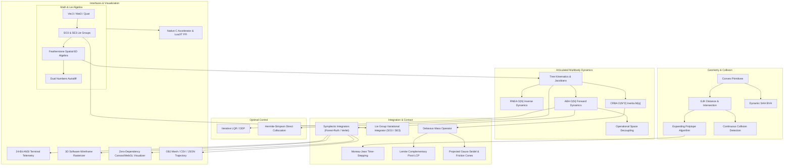

# fulcrum

> **Geometric mechanics, Lie group variational integrators, and articulated multibody dynamics built from the ground up in Lua with C kernel acceleration.**

[](tests/)
[](https://www.lua.org)
[](https://luajit.org)
[](LICENSE)

---

## Overview

**Fulcrum** is a high-precision computational physics and geometric mechanics framework designed for robotics, aerospace, and biomechanical simulation. Rather than relying on classical unconstrained Euclidean approximations and ad-hoc constraint stabilization, Fulcrum formulates the equations of motion directly on smooth configuration manifolds ($Q = \mathrm{SE}(3) \times \mathbb{T}^m \times \mathbb{R}^k$).

It integrates:
- **Featherstone 6D Spatial Algebra**: Inward/outward recursive passes implementing $O(N)$ Articulated Body Forward Dynamics (ABA), $O(N)$ Inverse Dynamics (RNEA), and $O(N^2)$ Composite Rigid Body generalized inertia calculation (CRBA).
- **Geometric & Symplectic Variational Integrators**: Discrete Euler-Poincaré equations on the Lie group $\mathrm{SO}(3)$, Störmer-Verlet, Forest-Ruth 4th-order symplectic, and Gauss-Legendre implicit Runge-Kutta, eliminating secular energy drift and preserving momentum invariants over millions of time steps.
- **Non-Smooth Contact Complementarity**: Moreau-Jean velocity-impulse time-stepping coupled with Delassus apparent mass operators, solved via Lemke complementary pivoting and Projected Gauss-Seidel (PGS) with Coulomb friction cone projections.
- **Computational Geometry & Continuous Collision Detection**: Minkowski difference support functions, Gilbert-Johnson-Keerthi (GJK), Expanding Polytope Algorithm (EPA), Dynamic AABB trees with Surface Area Heuristics (SAH), and conservative advancement continuous collision detection (CCD) to eliminate tunneling.
- **Optimal Trajectory Control**: Differential Dynamic Programming / Iterative Linear Quadratic Regulator (iLQR) and Hermite-Simpson direct collocation transcribed into Sequential Quadratic Programs (SQP).
- **Zero-Dependency 3D Visualizer**: Real-time 24-bit ANSI wireframe terminal rasterizer with depth buffering and an interactive browser-based Canvas/WebGL visualizer with orbit camera, live energy charts, and 5 interactive simulation scenarios.
- **Pure C Computational Kernels**: Shared C dynamic library and LuaJIT Foreign Function Interface (FFI) bindings providing high-throughput acceleration for vector, matrix, and contact operations.

---

## Architecture



For full mathematical derivations, proofs, and algorithmic details, see [ARCHITECTURE.md](ARCHITECTURE.md).

---

## Performance Benchmarks

All benchmarks are automated and verified across Lua 5.5 and LuaJIT 2.1 (`make bench`):

### 1. Forward Dynamics: Featherstone $O(N)$ ABA vs $O(N^3)$ CRBA + LU Inversion

Evaluated on kinematic open-chain serial manipulators from 2 to 25 degrees of freedom:

| Degrees of Freedom ($N$) | Featherstone ABA ($O(N)$) | CRBA + LU Inversion ($O(N^3)$) | Speedup | Agreement |
| :---: | :---: | :---: | :---: | :---: |
| **2** | 117.8 $\mu\mathrm{s}$ | 135.2 $\mu\mathrm{s}$ | **1.15x** | Exact ($< 10^{-6}$) |
| **4** | 274.2 $\mu\mathrm{s}$ | 349.4 $\mu\mathrm{s}$ | **1.27x** | Exact ($< 10^{-6}$) |
| **7** | 515.4 $\mu\mathrm{s}$ | 742.6 $\mu\mathrm{s}$ | **1.44x** | Exact ($< 10^{-6}$) |
| **12** | 899.0 $\mu\mathrm{s}$ | 1540.2 $\mu\mathrm{s}$ | **1.71x** | Exact ($< 10^{-6}$) |
| **18** | 1371.8 $\mu\mathrm{s}$ | 2885.6 $\mu\mathrm{s}$ | **2.10x** | Exact ($< 10^{-6}$) |
| **25** | 1926.0 $\mu\mathrm{s}$ | 4975.5 $\mu\mathrm{s}$ | **2.58x** | Exact ($< 10^{-6}$) |

### 2. Symplectic Invariant Conservation (10,000 Continuous Steps)

Evaluated on a high-amplitude nonlinear pendulum and intermediate-axis rigid body ($dt = 0.01$ s, $T = 100$ s):

| Numerical Integrator | Mathematical Class | Order | Maximum Energy Drift ($\Delta E / E_0$) | Runtime (ms) |
| :--- | :--- | :---: | :---: | :---: |
| **Explicit Euler** | Classical Forward Difference | 1st | $1.25 \times 10^{-1}$ (Diverges) | 1.3 ms |
| **Classical Runge-Kutta 4** | Standard Explicit RK4 | 4th | $3.89 \times 10^{-13}$ | 3.3 ms |
| **Symplectic Velocity Verlet** | Symplectic Kick-Drift-Kick | 2nd | **$4.30 \times 10^{-6}$** | 8.0 ms |
| **Forest-Ruth Symplectic** | Symplectic Composition | 4th | **$3.83 \times 10^{-12}$** | 10.9 ms |
| **Lie Group Variational (LGVI)** | Discrete Euler-Poincaré on $\mathrm{SO}(3)$ | Symplectic | **$2.54 \times 10^{-11}$** | 436.1 ms |

### 3. Contact Linear Complementarity Solvers

Comparison between Lemke exact complementary pivoting and Projected Gauss-Seidel (PGS) on multi-body contact Delassus matrices:

| Simultaneous Contacts ($k$) | Lemke Solve Time ($\mu\mathrm{s}$) | Lemke Residual ($\mathbf{w}^T \mathbf{z}$) | PGS Solve Time ($\mu\mathrm{s}$) | PGS Residual ($\mathbf{w}^T \mathbf{z}$) |
| :---: | :---: | :---: | :---: | :---: |
| **2** | 4.0 $\mu\mathrm{s}$ | $0.00 \times 10^{0}$ | 4.1 $\mu\mathrm{s}$ | $2.08 \times 10^{-6}$ |
| **4** | 12.5 $\mu\mathrm{s}$ | $4.81 \times 10^{-16}$ | 9.0 $\mu\mathrm{s}$ | $4.18 \times 10^{-6}$ |
| **8** | 56.8 $\mu\mathrm{s}$ | $2.48 \times 10^{-15}$ | 24.5 $\mu\mathrm{s}$ | $4.10 \times 10^{-6}$ |
| **16** | 293.7 $\mu\mathrm{s}$ | $2.05 \times 10^{-15}$ | 73.5 $\mu\mathrm{s}$ | $4.78 \times 10^{-6}$ |

---

## Quickstart

### Prerequisites

- Standard **Lua 5.1+** (or **LuaJIT 2.1+**)
- C compiler (e.g. `clang` or `gcc`) for compiling the native C accelerator kernels (`libfulcrum`)
- `make`

### Installation & Build

Clone the repository and compile the native C accelerator:

```bash
git clone https://github.com/Aneesh495/fulcrum.git
cd fulcrum
make c_lib
```

### Running Test Suites

Execute the comprehensive 106-test test suite across standard Lua and LuaJIT:

```bash
make test        # Runs test suite with standard Lua (106 tests)
make test-jit    # Runs test suite with LuaJIT JIT compiler
```

### Running Benchmarks

```bash
make bench       # Runs ABA vs CRBA, Symplectic Drift, and Lemke vs PGS benchmarks
```

---

## Demonstrations & Examples

Fulcrum includes 8 end-to-end executable demonstrations in `examples/`:

```bash
# 1. Dzhanibekov Effect (Intermediate-axis instability on SO(3) with terminal 3D rasterizer)
lua examples/01_dzhanibekov.lua

# 2. Chaotic Double Pendulum (Forest-Ruth 4th-order symplectic integration + CSV export)
lua examples/02_double_pendulum.lua

# 3. Newton's Cradle (5-ball impact propagation via Moreau-Jean Lemke LCP)
lua examples/03_newtons_cradle.lua

# 4. 7-DOF Manipulator Inverse Kinematics (Operational space Jacobian + SVD nullspace posture projection)
lua examples/04_manipulator_ik.lua

# 5. Planar Biped Locomotion (CPG limit cycle walking + Coulomb friction cone ground reactions)
lua examples/05_biped_locomotion.lua

# 6. 12-DOF Quadruped Trotting (Featherstone ABA forward dynamics + diagonal gait coordination)
lua examples/06_quadruped_trot.lua

# 7. Non-Linear Trajectory Optimization (iLQR / DDP pendulum swing-up + Direct Collocation SQP)
lua examples/07_trajectory_optimization.lua

# 8. Web Visualizer Export (Simulates and records 200-frame trajectory to web/trajectory.json)
lua examples/08_web_visualizer_export.lua
```

---

## Interactive Web Visualizer

Fulcrum includes a zero-dependency HTML5 Canvas/WebGL 3D visualizer in `web/`:

- **Real-Time Interactive Physics**: 5 live scenarios:
  1. *Dzhanibekov Rigid Body*: Intermediate-axis instability with angular momentum vector visualization.
  2. *Chaotic Double Pendulum*: Störmer-Verlet and Forest-Ruth symplectic trajectory trail.
  3. *Newton's Cradle*: 5-sphere collision wave propagation with restitution impulses.
  4. *7-DOF Anthropomorphic Arm*: Real-time inverse kinematics circle tracking.
  5. *Biped Walker*: Limit-cycle walking with ground friction contact forces.
- **Controls**:
  * Left-Click Drag: Orbit camera (azimuth / elevation)
  * Right-Click Drag: Pan camera
  * Scroll Wheel: Zoom in / out
  * Play / Pause / Step / Reset controls
  * Speed slider ($0.1\times$ to $3.0\times$)
  * Scrubber timeline for precomputed trajectory playback
- **Telemetry Display**:
  * Real-time 60 FPS performance counter
  * Symplectic energy drift meter ($\Delta E / E_0$)
  * Multi-channel kinetic vs potential energy graph
  * Live joint configuration and angular velocity telemetry

To open the visualizer, start any local HTTP server:

```bash
cd web && python3 -m http.server 8000
# Open http://localhost:8000 in any modern web browser
```

---

## Code Examples

### 1. Constructing an Articulated Robot via Fluent Builder

```lua
local fulcrum = require("fulcrum")
local vec3 = fulcrum.math.vec3
local builder = fulcrum.models.builder

local b = builder.new("scara_robot", vec3.new(0, 0, -9.81))
b:add_base("world", { mass = 0.0 })

b:add_link({
  name = "link1",
  parent = "world",
  joint_name = "joint1",
  joint_type = "revolute",
  axis = vec3.unit_z(),
  origin = { xyz = vec3.zero(), rpy = vec3.zero() },
  mass = 2.0,
  com = vec3.new(0.2, 0, 0),
  inertia = { ixx = 0.01, iyy = 0.05, izz = 0.05 }
})

local robot, meta = b:build()
```

### 2. Forward Dynamics with Featherstone ABA ($O(N)$)

```lua
local aba = fulcrum.dynamics.aba
local q = { 0.2 }        -- joint positions
local qd = { 0.5 }       -- joint velocities
local tau = { 0.0 }      -- joint torques

-- Computes joint accelerations q_ddot in O(N) operations
local qdd = aba.forward_dynamics(robot, q, qd, tau)
print("Joint 1 acceleration:", qdd[1])
```

### 3. Symplectic Lie Group Integration on $\mathrm{SO}(3)$

```lua
local lgvi = fulcrum.integrators.lgvi
local vec3 = fulcrum.math.vec3
local mat3 = fulcrum.math.mat3

local J_diag = vec3.new(1.0, 2.0, 3.5) -- principal rotational inertias
local R = mat3.identity()              -- initial attitude
local Omega = vec3.new(0.01, 3.0, 0.0) -- initial body angular velocity
local dt = 0.005

-- Discrete Euler-Poincaré step: strictly preserves symplecticity and angular momentum
for step = 1, 1000 do
  R, Omega = lgvi.step_so3(R, Omega, J_diag, nil, dt)
end
```

### 4. Direct Collocation Trajectory Optimization

```lua
local collocation = fulcrum.opt.collocation

local prob = {
  n_x = 2,
  n_u = 1,
  segments = 8,
  duration = 1.0,
  x_start = { 0.0, 0.0 },
  x_goal = { 1.0, 0.0 },
  dynamics = function(x, u) return { x[2], u[1] } end,
  cost = function(_, u) return 0.5 * u[1] * u[1] end
}

local solution = collocation.solve(prob)
print(string.format("Optimized Effort Cost: %.4f", solution.cost))
```

---

## License

This project is licensed under the MIT License. See [LICENSE](LICENSE) for details.
